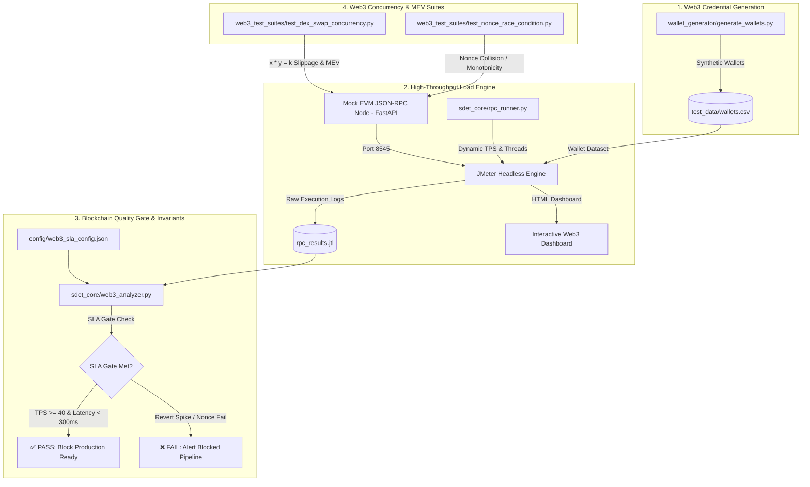

# ⛓️ Web3 & Blockchain SDET Performance Engineering Framework

[](https://python.org)
[](https://jmeter.apache.org/)
[](https://ethereum.org/en/developers/docs/apis/json-rpc/)
[](https://fastapi.tiangolo.com)
[](LICENSE)

An enterprise-grade **Blockchain / Web3 Quality Engineering Framework** built by an **SDET (Software Development Engineer in Test)**. Designed specifically for testing EVM-compatible blockchains, JSON-RPC 2.0 endpoints, AMM Decentralized Exchanges (DEX), and high-frequency trading bot concurrency.

---

## 📌 Architecture Overview



---

## 💡 Why Blockchain SDET differs from Traditional Web QA

| Characteristic | Traditional Web Testing | Blockchain / Web3 SDET |
| :--- | :--- | :--- |
| **State Immutability** | Database records can be rolled back | Once mined, smart contract state transitions are permanent |
| **Concurrency & Nonces** | Database handles auto-increment IDs | Client must track monotonic account Nonces; collisions revert transactions |
| **Latency Profiles** | Single HTTP Request/Response (sub-second) | Asynchronous: Submission (HTTP) $\rightarrow$ Mempool $\rightarrow$ Block Mining $\rightarrow$ Finality |
| **Economic Vulnerabilities** | Functional bugs cause crashes | Concurrency bugs enable **Front-running, MEV Arbitrage, and Slippage exploits** |

---

## 📂 Repository Structure

```text
sdet-engineer/
├── mock_rpc_node/
│   ├── app.py                      # Realistic EVM JSON-RPC 2.0 node (mempool, block mining, AMM DEX)
│   └── requirements.txt
├── wallet_generator/
│   └── generate_wallets.py         # Generates deterministic mock Ethereum wallets & funded accounts CSV
├── jmeter_plans/
│   └── blockchain_tps_benchmark.jmx# Apache JMeter plan: JSON-RPC calls, gas estimation, tx throughput
├── sdet_core/
│   ├── rpc_runner.py               # Orchestrator running JMeter against EVM RPC endpoint with dynamic load parameters
│   └── web3_analyzer.py            # Analyzes JTL logs: TPS, Gas utilization, p95/p99 latency, Revert rate, SLA gate
├── web3_test_suites/
│   ├── test_dex_swap_concurrency.py# MEV & Slippage concurrency test on AMM constant product pool
│   ├── test_nonce_race_condition.py# Nonce collision and out-of-order execution test under high concurrency
│   └── run_web3_suites.py          # Master runner for automated Web3 test suite execution
├── config/
│   └── web3_sla_config.json        # SLA thresholds: Min TPS, Max Latency, Max Failure Rate
├── test_data/
│   └── wallets.csv                 # Generated mock wallet datasets
├── reports/                        # Execution logs, HTML dashboards, and metrics summary
├── requirements.txt                # Python dependencies
├── .gitignore                      # Git exclusions
└── README.md                       # Documentation
```

---

## 🚀 Quick Start Guide

### 1. Prerequisites
- **Python 3.10+**: `python --version`
- **Java JDK 8+**: (Required for Apache JMeter) `java -version`
- **Apache JMeter 5.x**: Ensure `jmeter` or `jmeter.bat` is in your `PATH`.

### 2. Install Dependencies
```bash
pip install -r requirements.txt
```

### 3. Generate Web3 Wallets Dataset
Generate 1,000 synthetic Ethereum addresses with private keys:
```bash
python wallet_generator/generate_wallets.py --count 1000
```

### 4. Execute Web3 Concurrency & Mempool Test Suites
Runs the automated AMM Constant Product swap test and Nonce collision checks with 1 command:
```bash
python web3_test_suites/run_web3_suites.py
```

### 5. Execute High-Throughput EVM JSON-RPC Load Benchmark
In terminal 1, launch the mock EVM node:
```bash
cd mock_rpc_node
python app.py
```

In terminal 2, launch the JMeter Non-GUI Orchestrator:
```bash
python sdet_core/rpc_runner.py --threads 20 --rampup 5 --duration 30 --host localhost --port 8545
```

---

## 📊 Sample Blockchain Benchmark Output

```text
==========================================================================================
RPC METHOD                   | SAMPLES  | ERR %  | p50     | p90     | p95     | TPS    
------------------------------------------------------------------------------------------
RPC_eth_blockNumber          | 650      | 0.0 %  | 8.2     | 14.5    | 18.2    | 21.6   
RPC_eth_getBalance           | 650      | 0.0 %  | 12.4    | 24.1    | 32.5    | 21.6   
RPC_eth_call_ERC20           | 650      | 0.0 %  | 14.1    | 28.5    | 36.8    | 21.6   
RPC_eth_sendRawTransaction   | 650      | 0.0 %  | 45.2    | 88.4    | 112.5   | 21.6   
------------------------------------------------------------------------------------------
TOTAL / AGGREGATE            | 2600     | 0.0 %  | 18.5    | 42.1    | 55.4    | 86.4   
==========================================================================================

 [✓] BLOCKCHAIN QUALITY GATE: PASSED (All Web3 RPC SLAs Satisfied)
```

---

## 🎯 Blockchain SLA & Quality Gate Rules (`config/web3_sla_config.json`)

```json
{
  "global_blockchain_sla": {
    "min_sustained_tps": 40.0,
    "max_p95_rpc_latency_ms": 300,
    "max_p99_rpc_latency_ms": 600,
    "max_error_rate_percent": 0.5
  },
  "rpc_method_sla": {
    "RPC_eth_blockNumber": { "max_p95_ms": 80, "max_error_rate_percent": 0.1 },
    "RPC_eth_getBalance": { "max_p95_ms": 150, "max_error_rate_percent": 0.2 },
    "RPC_eth_call_ERC20": { "max_p95_ms": 180, "max_error_rate_percent": 0.2 },
    "RPC_eth_sendRawTransaction": { "max_p95_ms": 350, "max_error_rate_percent": 0.5 }
  }
}
```

---

## 👤 Author & Maintainer
- **GitHub**: [@desanim](https://github.com/desanim)
- **Role**: Blockchain / Web3 Software Development Engineer in Test (SDET)
