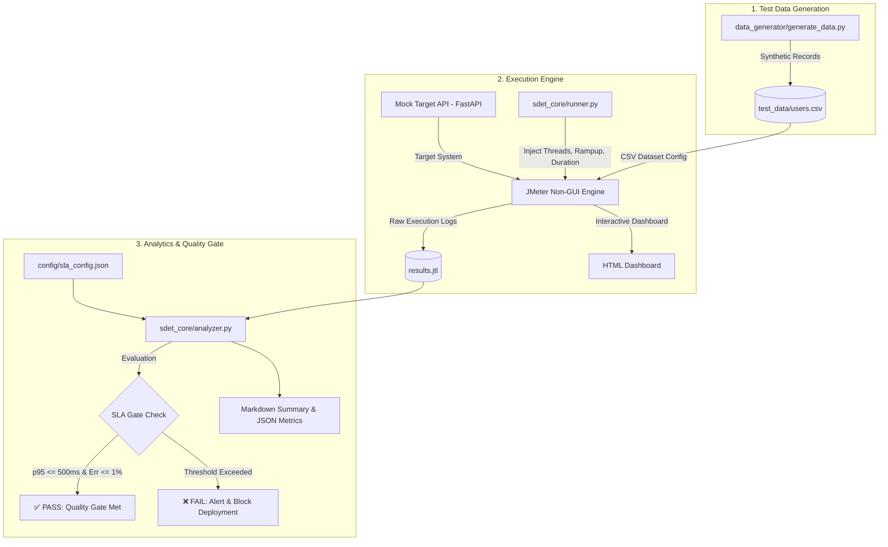

# 🚀 SDET Performance Testing Engine (JMeter + Python)

[](https://python.org)
[](https://jmeter.apache.org/)
[](https://fastapi.tiangolo.com)
[](LICENSE)

An enterprise-grade **Performance Testing & Quality Gate Framework** built by an **SDET (Software Development Engineer in Test)**. This framework seamlessly integrates the robust load generation power of **Apache JMeter** with the automation, data analytics, and CI/CD capabilities of **Python**.

---

## 📌 Architecture Overview



---

## 💡 SDET Mindset vs. Traditional Testing

| Feature | Traditional Performance Tester | SDET Framework Approach |
| :--- | :--- | :--- |
| **Execution** | Manual GUI clicking & ad-hoc runs | Headless, parameterized orchestration via Python CLI |
| **Data Setup** | Static, manually created spreadsheets | Dynamic synthetic generation (`generate_data.py`) |
| **Analysis** | Manual inspection of HTML graphs | Automated `.jtl` log parsing, percentile math & SLA gates |
| **CI/CD Integration** | Rarely integrated into pipelines | Continuous quality gates blocking regression |

---

## 📂 Repository Structure

```
sdet-performance-engine/
├── mock_api/
│   ├── app.py                     # Realistic FastAPI target (Auth, Catalog, Orders)
│   └── requirements.txt           # FastAPI dependencies
├── data_generator/
│   └── generate_data.py           # Synthetic dataset generator for JMeter
├── jmeter_plans/
│   └── ecommerce_performance_test.jmx # Parameterized Apache JMeter 5.x test plan
├── sdet_core/
│   ├── runner.py                  # Python Non-GUI Test Orchestrator
│   └── analyzer.py                # Percentile math, SLA evaluator & report generator
├── config/
│   └── sla_config.json            # SLA threshold definitions (global & per-transaction)
├── test_data/
│   └── users.csv                  # Generated test datasets
├── reports/                       # Generated run artifacts (.jtl, HTML dashboard, summary)
├── requirements.txt               # Project Python dependencies
├── .gitignore                     # Git exclusions
└── README.md                      # Documentation
```

---

## 🛠️ Quick Start Guide

### 1. Prerequisites
- **Python 3.10+**: Verify with `python --version`
- **Java JDK 8+**: (Required by JMeter) Verify with `java -version`
- **Apache JMeter 5.x**: Download from [Apache JMeter Official Site](https://jmeter.apache.org/download_jmeter.cgi) and ensure `jmeter` or `jmeter.bat` is in your `PATH`.

### 2. Install Python Dependencies
```bash
pip install -r requirements.txt
```

### 3. Start the Mock API Server
In a separate terminal, launch the target API:
```bash
cd mock_api
python -m uvicorn app:app --host 0.0.0.0 --port 8000
```
Verify readiness at `http://localhost:8000/health`.

### 4. Generate Test Data
Generate 1,000 synthetic test accounts:
```bash
python data_generator/generate_data.py --count 1000
```

### 5. Execute Performance Test & Quality Gate
Run the complete automated flow (JMeter non-GUI + SLA analyzer) with a single command:
```bash
python sdet_core/runner.py --threads 15 --rampup 5 --duration 30 --host localhost --port 8000
```

---

## 📊 Sample Performance Summary Output

When the test completes, `sdet_core/analyzer.py` calculates statistical percentiles and prints the quality gate result:

```text
==========================================================================================
TRANSACTION            | SAMPLES  | ERR %  | AVG     | p90     | p95     | p99     | RPS   
------------------------------------------------------------------------------------------
POST_Login             | 450      | 0.0 %  | 54.2    | 72.1    | 78.4    | 88.0    | 15.0  
GET_Products           | 450      | 0.0 %  | 68.1    | 89.5    | 97.2    | 112.5   | 15.0  
POST_CreateOrder       | 450      | 0.0 %  | 132.8   | 165.0   | 174.6   | 192.1   | 15.0  
------------------------------------------------------------------------------------------
TOTAL / SUMMARY        | 1350     | 0.0 %  | 85.0    | 128.4   | 155.0   | 185.3   | 45.0  
==========================================================================================

 [✓] QUALITY GATE RESULT: PASSED (All performance SLAs are satisfied)
```

---

## 🎯 SLA & Quality Gate Rules (`config/sla_config.json`)

```json
{
  "global_sla": {
    "max_error_rate_percent": 1.0,
    "max_p95_response_time_ms": 500,
    "max_p99_response_time_ms": 1000,
    "min_throughput_rps": 20.0
  },
  "transaction_sla": {
    "POST_Login": { "max_p95_ms": 300, "max_error_rate_percent": 0.5 },
    "GET_Products": { "max_p95_ms": 250, "max_error_rate_percent": 0.5 },
    "POST_CreateOrder": { "max_p95_ms": 450, "max_error_rate_percent": 1.0 }
  }
}
```

If any metric breaches the threshold, the runner automatically exits with **exit code 1**, preventing flawed builds from reaching production.

---

## 👤 Author & Maintainer
- **GitHub**: [@desanim](https://github.com/desanim)
- **Role**: Software Development Engineer in Test (SDET)
