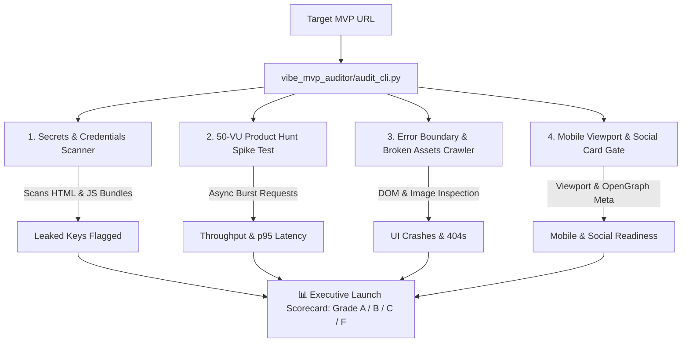

# 🚀 Vibe-App MVP Launch-Readiness & Security Auditor

A specialized, black-box **Launch-Readiness & Security Audit Engine** built for AI-generated and **Vibe-Coded MVPs** (built via Lovable, Bolt.new, Cursor, v0, or Replit Agent).

---

## 📌 The Problem: Why 90% of Vibe-Coded MVPs Break on Launch Day

Founders and indie hackers ship MVPs in hours using prompt-driven coding tools. However, these applications suffer from systemic vulnerabilities:
1. **Critical Secret Leaks:** AI prompts frequently bundle `STRIPE_SECRET_KEY`, `OPENAI_API_KEY`, or `SUPABASE_SERVICE_ROLE_KEY` directly into client-side JavaScript bundles.
2. **Product Hunt Spike Crash:** Free-tier backends (Supabase, Render, Neon) choke when 50 concurrent upvoters hit the landing page at midnight.
3. **White Screen of Death (React Error Boundaries):** Null data in unhandled states causes React to crash silently.
4. **Broken Mobile UX:** Missing viewport tags and unoptimized touch targets lead to high mobile bounce rates.

This engine audits any MVP in **60 seconds** and produces an executive **Launch-Readiness Scorecard (Grade A to F)**.

---

## 🏗️ The 4 Core Audit Modules



---

## 📂 Directory Structure

```text
vibe_mvp_auditor/
├── scanners/
│   ├── __init__.py
│   ├── secrets_scanner.py         # Regex & entropy scanner for Stripe, OpenAI, Supabase, AWS keys
│   ├── spike_load_tester.py       # Async burst load tester simulating Product Hunt traffic surge
│   ├── error_boundary_crawler.py  # Crawls for React crash signatures and broken image/asset links
│   └── mobile_ux_gate.py          # Validates mobile viewport and OpenGraph social preview cards
├── mock_target_mvp/
│   ├── app.py                     # Realistic Vibe-Coded MVP app (FastAPI) with intentional test defects
│   ├── static/bundle.js           # Client bundle containing simulated test leaks to verify scanner accuracy
│   └── templates/index.html       # Landing page template
├── reports/                       # Generated audit reports (Markdown & JSON)
├── audit_cli.py                   # Master 1-click CLI runner
└── README.md                      # Documentation
```

---

## ⚡ How to Run the Audit

### 1. Test Against the Included Mock Vibe MVP (Zero Setup)
```bash
python vibe_mvp_auditor/audit_cli.py
```
*(Automatically starts the mock Vibe MVP server on port 8888, audits it, and shuts it down cleanly).*

### 2. Audit Any Live Public Vibe MVP or Staging URL
```bash
python vibe_mvp_auditor/audit_cli.py --target-url https://my-vibe-app.vercel.app
```

---

## 📊 Sample Audit Output

```text
=====================================================================================
 🚀 VIBE-APP MVP LAUNCH-READINESS & SECURITY AUDIT ENGINE 
=====================================================================================
 • Target MVP URL   : http://127.0.0.1:8888
 • Audit Scope      : Client Secrets | Traffic Spike | UI Crashes | Mobile UX
=====================================================================================

[1/4] Scanning HTML & JavaScript Bundles for Exposed API Keys...
 -> Found 2 secret exposure(s) across 2 asset(s).
    • [CRITICAL] Stripe Secret Key (sk_live_...mnop) in JS Bundle: /static/bundle.js
    • [CRITICAL] OpenAI API Key (sk-proj-...hhhh) in JS Bundle: /static/bundle.js

[2/4] Executing 50-User Burst Traffic Spike Test (Product Hunt Simulation)...
 -> Dispatched 540 requests | Throughput: 104.2 RPS
 -> Latency p50: 64.2ms | p95: 112.5ms | 5xx Errors: 0.0%

[3/4] Crawling for Unhandled React Crashes & Broken Assets...
 -> UI Crashes Detected : 0
 -> Broken Image Assets : 1 (/static/non-existent-sample.png)

[4/4] Verifying Mobile Viewport & OpenGraph Viral Sharing Meta...
 -> Passed Checks : 3
 -> Detected Issues: 0

=====================================================================================
 📊 VIBE-CODED MVP LAUNCH-READINESS SCORECARD 
=====================================================================================
 OVERALL GRADE     : [ F ]
 VERDICT           : 🔴 DO NOT LAUNCH (Critical Security Leak or Severe Instability)
-------------------------------------------------------------------------------------
 • Leaked Credentials        : 2 issues (2 Critical)
 • Spike Latency (p95)       : 112.5ms (5xx Error Rate: 0.0%)
 • Broken Images / Assets    : 1 broken links
 • Mobile & OpenGraph Meta   : Optimized
=====================================================================================
```

---

## 🎯 Grading & Quality Gate Scale

| Grade | Classification | Criteria | Action Required |
| :--- | :--- | :--- | :--- |
| **Grade A** | 🟢 **LAUNCH READY** | 0 Leaks, 5xx Rate $< 1\%$, p95 $< 1000\text{ms}$, 0 Broken Assets, Valid Mobile Meta | Ready to submit to Product Hunt |
| **Grade B** | 🟡 **LAUNCH WITH CAUTION** | 0 Critical Leaks, 5xx Rate $< 3\%$, Minor asset or social meta warnings | Deployable with minor fixes |
| **Grade C** | 🟠 **HIGH RISK** | High latency ($> 2000\text{ms}$), 5xx errors ($> 5\%$), or multiple broken assets | Needs backend performance optimization |
| **Grade F** | 🔴 **DO NOT LAUNCH** | **Exposed Stripe/OpenAI/Supabase Secret Keys** OR Fatal White-Screen Crashes | Immediate blocker. Leaked keys must be revoked |
